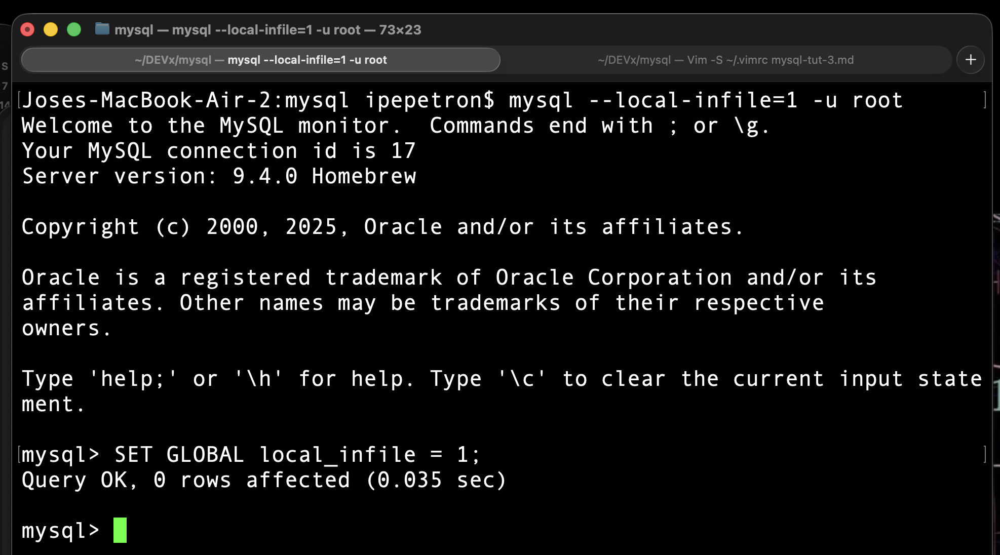
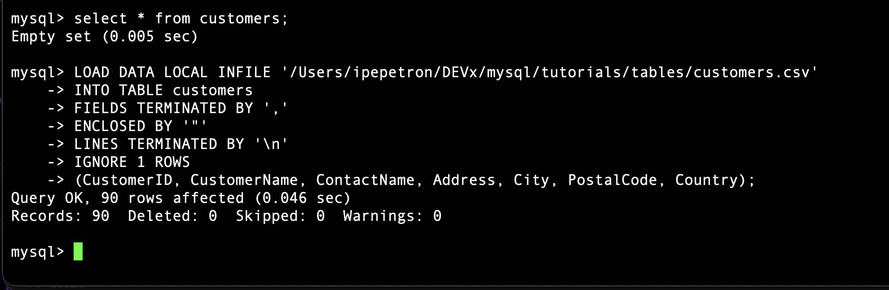
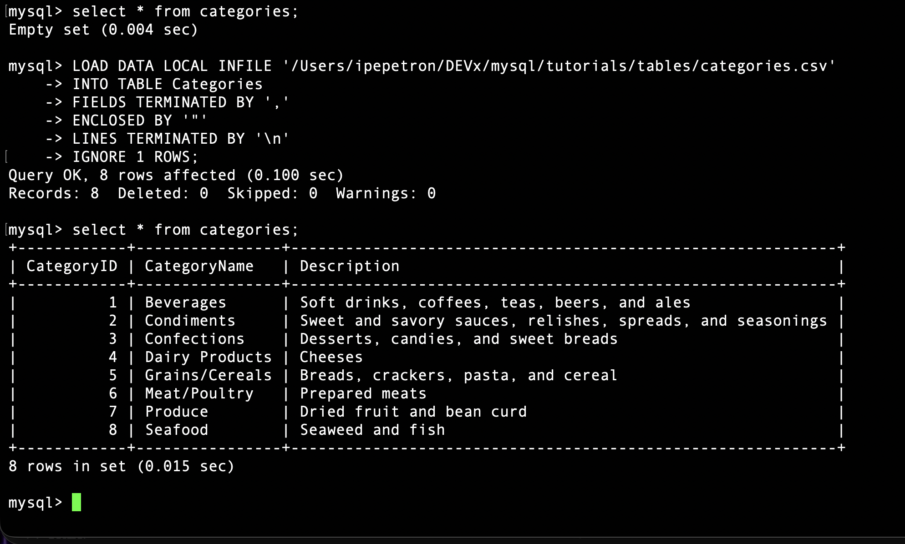

# 🧱 Tutorial MySQL — Creación de la BD w3schools: Tablas y Carga de Archivos CSV


## 🧩 Sección 1. Creación de la BD **w3schools** y de las tablas

### Ingresa a el servidor MySql

```sql
ipepetron$ mysql -u root
```

### Creación de la BD w3shools

```sql
mysql> CREATE DATABASE w3schools;

mysql> USE w3schools;

mysql> SHOW DATABASES;
```

### A continuación se definen las sentencias SQL para crear todas las tablas del sistema.

```sql
-- Tabla: customers
CREATE TABLE customers (
    CustomerID INT PRIMARY KEY,
    CustomerName VARCHAR(100) NOT NULL,
    ContactName VARCHAR(100),
    Address VARCHAR(150),
    City VARCHAR(50),
    PostalCode VARCHAR(15),
    Country VARCHAR(50)
);

-- Tabla: employees
CREATE TABLE employees (
    EmployeeID INT PRIMARY KEY,
    LastName VARCHAR(50) NOT NULL,
    FirstName VARCHAR(50) NOT NULL,
    BirthDate DATE NOT NULL,
    Notes TEXT CHARACTER SET utf8mb4
);

-- Tabla: shippers
CREATE TABLE shippers (
    ShipperID INT PRIMARY KEY,
    ShipperName VARCHAR(100) NOT NULL,
    Phone VARCHAR(30)
);

-- Tabla: suppliers
CREATE TABLE suppliers (
    SupplierID INT PRIMARY KEY,
    SupplierName VARCHAR(100) NOT NULL,
    ContactName VARCHAR(100),
    Address VARCHAR(150),
    City VARCHAR(50),
    PostalCode VARCHAR(15),
    Country VARCHAR(50),
    Phone VARCHAR(30)
);

-- Tabla: products
CREATE TABLE products (
    ProductID INT PRIMARY KEY,
    ProductName VARCHAR(100) NOT NULL,
    SupplierID INT,
    CategoryID INT,
    Unit VARCHAR(50),
    Price DECIMAL(10,2),
    FOREIGN KEY (SupplierID) REFERENCES suppliers(SupplierID)
);


-- Tabla categories

CREATE TABLE Categories (
  CategoryID INT PRIMARY KEY,
  CategoryName VARCHAR(50) NOT NULL,
  Description VARCHAR(255)
);

-- Tabla: orders
CREATE TABLE orders (
    OrderID INT PRIMARY KEY,
    CustomerID INT,
    EmployeeID INT,
    OrderDate DATE,
    ShipperID INT,
    FOREIGN KEY (CustomerID) REFERENCES customers(CustomerID),
    FOREIGN KEY (EmployeeID) REFERENCES employees(EmployeeID),
    FOREIGN KEY (ShipperID) REFERENCES shippers(ShipperID)
);

-- Tabla: order_details
CREATE TABLE order_details (
    OrderDetailID INT PRIMARY KEY,
    OrderID INT,
    ProductID INT,
    Quantity INT,
    FOREIGN KEY (OrderID) REFERENCES orders(OrderID),
    FOREIGN KEY (ProductID) REFERENCES products(ProductID)
);
```

---

## 📂 Sección 2. Carga de archivos CSV a las tablas de la BD w3schools

Una vez creadas la BD  y las tablas: 

+ Salir del servidor MySql **para configurar la carga de arhivos locales; precisamente al servidor**
+ Crea una carpeta -local- para guardar los archivos **.csv** que contienen los récords (databases/tables) por cargar a su tabla respectiva en la  BD w3shools...  ésta -por ejemplo- es mi carpeta local:/Users/ipepetron/DEVx/mysql/tut/

+ Descargar -en tu carpeta local- los archivos .csv del repo de Github, ubicados en la siguiente tura: databases/tables/

+ Conectarse nuevamente, al servidor  MySql, como cliente con la opción `--local-infile=1`:
>    ```bash
>    mysql --local-infile=1 -u root
>   

---

Antes de cargar los archivos **.csv**, habilita el uso de archivos locales en MySQL:

```sql
mysql> SET GLOBAL local_infile = 1;
```




---

Ahora sí, al ataque mis valientes, a cargar los datos en las tablas previamente creadas (**Sección 1**). Para dicho propósito se empleará la siguiente **SENTENCIA DML (LOAD DATA LOCAL INFILE)**:


```sql
LOAD DATA LOCAL INFILE '/ruta-absoluta-a-tu-carpeta-local/productos.csv'
INTO TABLE Productos
FIELDS TERMINATED BY ','
ENCLOSED BY '"'
LINES TERMINATED BY '\n'
IGNORE 1 ROWS;
```

### 🔹 Cargar `customers.csv`

```sql
USE w3chools;
```

---

```sql
LOAD DATA LOCAL INFILE '/ruta-abosuluta-a/customers.csv'
INTO TABLE customers
FIELDS TERMINATED BY ',' 
ENCLOSED BY '"' 
LINES TERMINATED BY '\n'
IGNORE 1 ROWS
(CustomerID, CustomerName, ContactName, Address, City, PostalCode, Country);
```



---

### 🔹 Cargar `employees.csv`

```sql
LOAD DATA LOCAL INFILE '/ruta-absoluta-a/employees.csv'
INTO TABLE employees
FIELDS TERMINATED BY ',' 
ENCLOSED BY '"' 
LINES TERMINATED BY '\n'
IGNORE 1 ROWS
(EmployeeID, LastName, FirstName, BirthDate, Notes);
```

---

### 🔹 Cargar `orders.csv`

```sql
LOAD DATA LOCAL INFILE '/ruta-absoluta-a/orders.csv'
INTO TABLE orders
FIELDS TERMINATED BY ',' 
ENCLOSED BY '"' 
LINES TERMINATED BY '\n'
IGNORE 1 ROWS
(OrderID, CustomerID, EmployeeID, OrderDate, ShipperID);
```

---

### 🔹 Cargar `order_details.csv`

```sql
LOAD DATA LOCAL INFILE '/ruta-absoluta-a/order_details.csv'
INTO TABLE order_details
FIELDS TERMINATED BY ',' 
ENCLOSED BY '"' 
LINES TERMINATED BY '\n'
IGNORE 1 ROWS
(OrderDetailID, OrderID, ProductID, Quantity);
```

---

### 🔹 Cargar `products.csv`

```sql
LOAD DATA LOCAL INFILE '/ruta-absoluta-a/products.csv'
INTO TABLE products
FIELDS TERMINATED BY ',' 
ENCLOSED BY '"' 
LINES TERMINATED BY '\n'
IGNORE 1 ROWS
(ProductID, ProductName, SupplierID, CategoryID, Unit, Price);
```

---

### 🔹 Cargar `categories.csv`

```sql
LOAD DATA LOCAL INFILE '/ruta-absoluta-a/categories.csv'
INTO TABLE Categories
FIELDS TERMINATED BY ','
ENCLOSED BY '"'
LINES TERMINATED BY '\n'
IGNORE 1 ROWS;
```




---

### 🔹 Cargar `shippers.csv`

```sql
LOAD DATA LOCAL INFILE '/ruta-absoluta-a/shippers.csv'
INTO TABLE shippers
FIELDS TERMINATED BY ',' 
ENCLOSED BY '"' 
LINES TERMINATED BY '\n'
IGNORE 1 ROWS
(ShipperID, ShipperName, Phone);
```

---

### 🔹 Cargar `suppliers.csv`

```sql
LOAD DATA LOCAL INFILE '/ruta-absoluta-a/suppliers.csv'
INTO TABLE suppliers
FIELDS TERMINATED BY ',' 
ENCLOSED BY '"' 
LINES TERMINATED BY '\n'
IGNORE 1 ROWS
(SupplierID, SupplierName, ContactName, Address, City, PostalCode, Country, Phone);
```

---

## ✅ Verificación de carga

Ejecuta para verificar cuántos registros se cargaron correctamente:

```sql
SELECT COUNT(*) FROM customers;
SELECT COUNT(*) FROM employees;
SELECT COUNT(*) FROM orders;
SELECT COUNT(*) FROM order_details;
SELECT COUNT(*) FROM products;
SELECT COUNT(*) FROM shippers;
SELECT COUNT(*) FROM suppliers;
```
