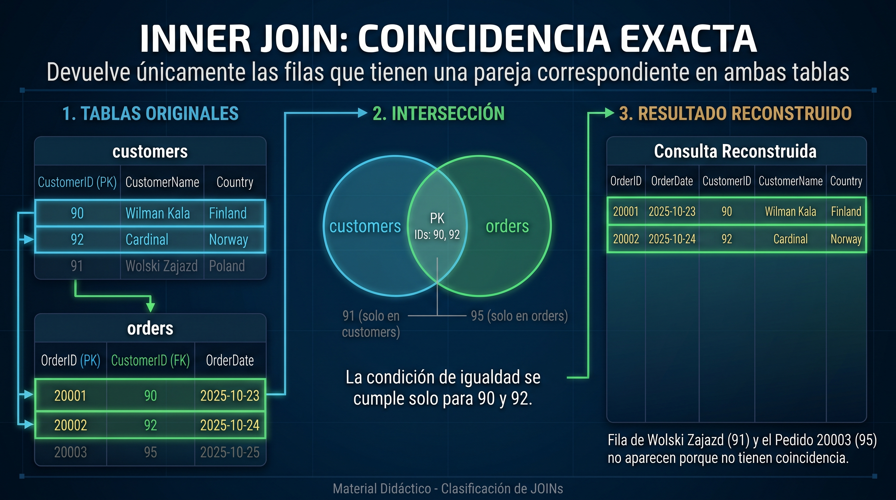
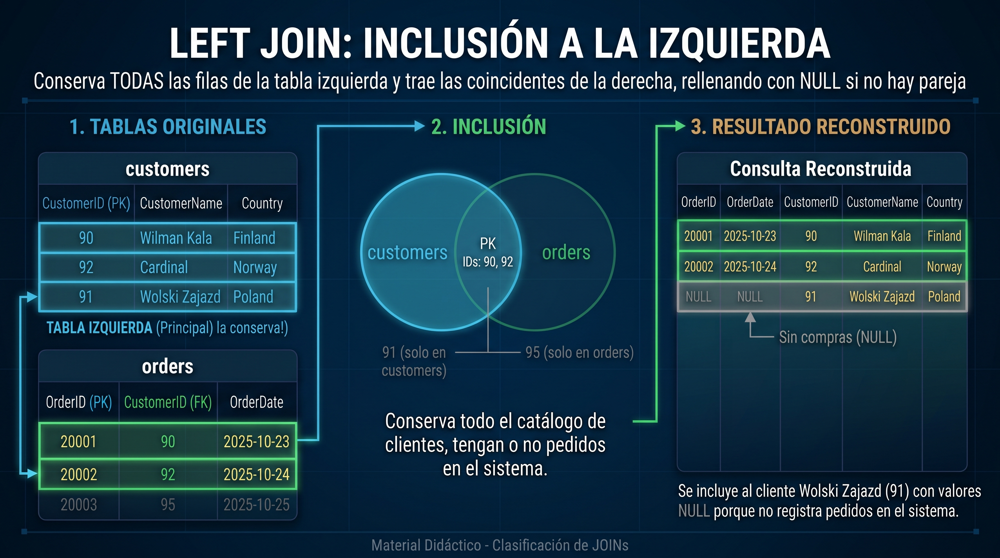
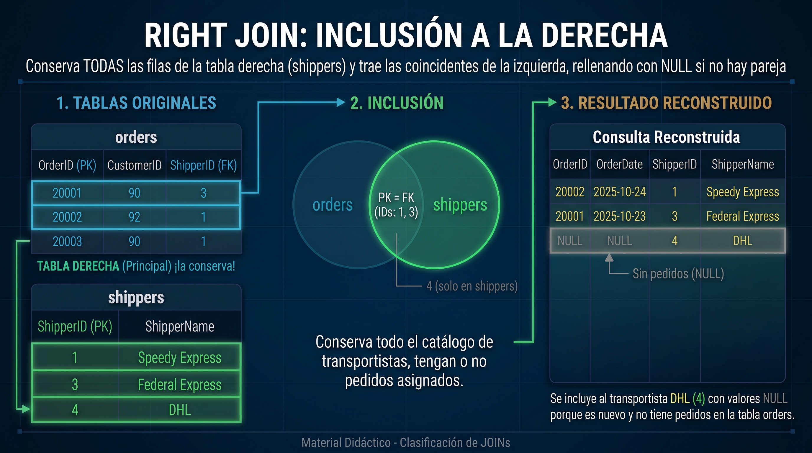
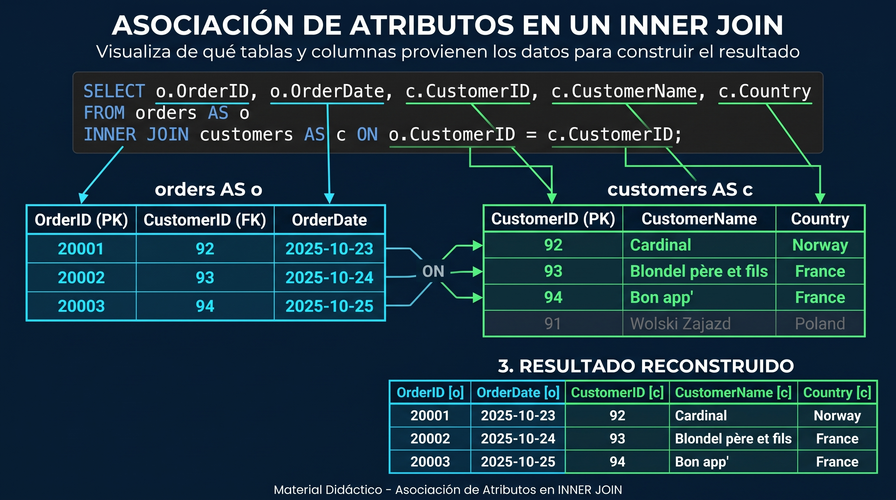
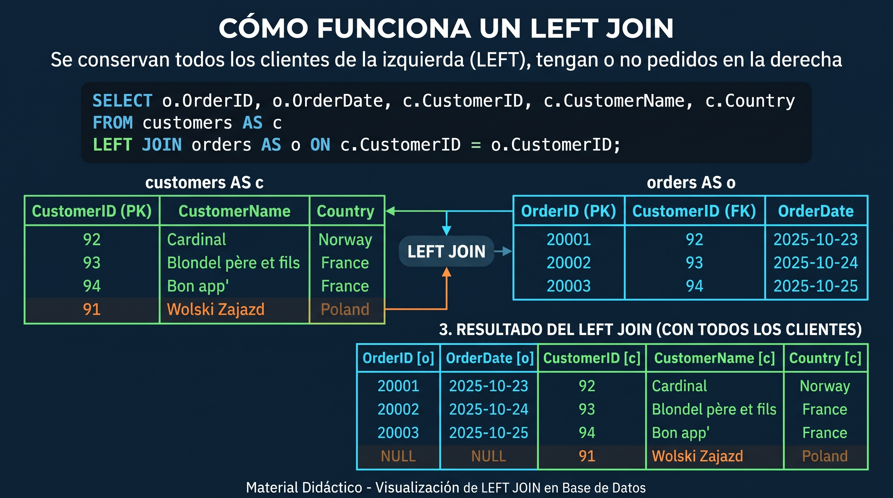
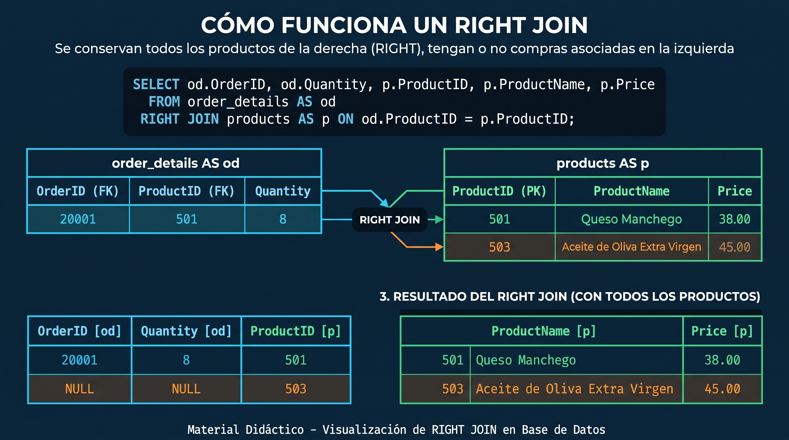
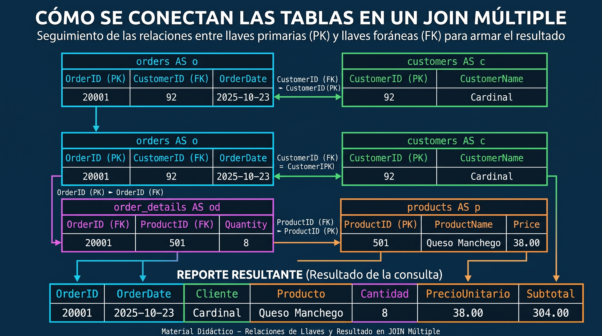

# 🔗 Tutorial MySQL: Consultas Multitabla con `JOIN`


## 🧠 1. Fundamentos `JOIN`

* Cuando normalizamos una base de datos relacional, dividimos la información en múltiples tablas independientes (como `customers`, `orders`, `order_details` y `products`) para evitar redundancia y anomalías.

* Estas tablas quedan enlazadas mediante **llaves primarias (`PRIMARY KEY`)** y **llaves foráneas (`FOREIGN KEY`)**.

* El operador **`JOIN`** es el mecanismo SQL que permite **reconstruir esa información fragmentada en tiempo de consulta**, combinando columnas de dos o más tablas mediante una condición lógica de coincidencia.

### Clasificación esencial de los `JOIN`

* **`INNER JOIN` (Intersección):** Devuelve únicamente las filas donde existe coincidencia exacta en **ambas** tablas.

<p align="center">
  
</p>

* **`LEFT JOIN` / `LEFT OUTER JOIN` (Inclusión izquierda):** Devuelve **todas** las filas de la tabla izquierda y las filas coincidentes de la tabla derecha. Cuando no hay coincidencia, rellena las columnas de la derecha con `NULL`.

<p align="center">
  
</p>

* **`RIGHT JOIN` / `RIGHT OUTER JOIN` (Inclusión derecha):** Devuelve **todas** las filas de la tabla derecha y las filas coincidentes de la tabla izquierda (o `NULL` si no existen).

<p align="center">
  
</p>


### 💡 ¿Para qué sirven los valores `NULL` en un `LEFT` o `RIGHT JOIN`?

En el análisis de datos, un **`NULL`** generado por un `OUTER JOIN` representa **ausencia de relación**, lo que permite descubrir información crítica que un `INNER JOIN` ocultaría:

* **Detectar inactividad (`WHERE ... IS NULL`):** Identifica clientes sin compras, productos sin ventas o transportistas sin envíos asignados para tomar decisiones de negocio (campañas de reactivación, liquidación de inventario).

* **Reportes maestros completos:** Permite listar todo un catálogo (por ejemplo, todos los empleados o transportistas) mostrando `0` en sus métricas de actividad (`COUNT(o.OrderID)`) en lugar de eliminarlos del informe.

* **Auditoría de datos:** Ayuda a localizar registros huérfanos o inconsistencias en bases de datos sin llaves foráneas estrictas.


---

## 📐 2. Sintaxis General en MySQL

En MySQL, la estructura estándar para unir dos tablas sigue esta sintaxis explícita:

```sql
SELECT 
    t1.columna1,
    t1.columna2,
    t2.columna3
FROM tabla_izquierda AS t1
[INNER | LEFT | RIGHT] JOIN tabla_derecha AS t2
    ON t1.llave_primaria = t2.llave_foranea;
```

### 💡 Reglas y buenas prácticas en MySQL

1. **Uso de alias de tabla (`t1`, `t2` o iniciales como `c`, `o`, `p`):** Abrevian la escritura y son obligatorios cuando ambas tablas tienen columnas con el mismo nombre (por ejemplo, `CustomerID` en `customers` y en `orders`) para evitar el error `Column 'CustomerID' in field list is ambiguous`.

2. **Cláusula `ON` vs. `WHERE`:** La cláusula `ON` define **cómo se enlazan las tablas** (generalmente igualando `PK = FK`), mientras que `WHERE` filtra el resultado final.

3. **La palabra clave `OUTER` es opcional:** En MySQL, escribir `LEFT JOIN` es exactamente equivalente a escribir `LEFT OUTER JOIN`.


---

## 🛠️ 3. Actualización de la Base de Datos


1. **Creación segura (`CREATE TABLE IF NOT EXISTS`):** Crea las tablas necesarias (`customers`, `shippers`, `products`, `orders` y `order_details`) únicamente si aún no existen en tu esquema activo, respetando la jerarquía entre llaves primarias y foráneas.

2. **Inserción idempotente (`INSERT IGNORE INTO`):** Inserta los registros exactos verificados en los diagramas (`CustomerID` `91`, `92`, `93`, `94`; `OrderID` `20001`, `20002`, `20003`; `ProductID` `501`, `503`), ignorando registros duplicados sin arrojar errores de clave primaria (`Error 1062`).

```sql
-- ============================================================================
-- SETTING UP: CREACIÓN DE TABLAS E INSERCIÓN DE DATOS PARA TODOS LOS EJEMPLOS
-- ============================================================================

-- 1. Crear tablas catálogo (Tablas Padre) si no existen
CREATE TABLE IF NOT EXISTS customers (
    CustomerID INT PRIMARY KEY,
    CustomerName VARCHAR(100) NOT NULL,
    ContactName VARCHAR(100),
    Address VARCHAR(150),
    City VARCHAR(100),
    PostalCode VARCHAR(20),
    Country VARCHAR(50)
);

CREATE TABLE IF NOT EXISTS shippers (
    ShipperID INT PRIMARY KEY,
    ShipperName VARCHAR(100) NOT NULL,
    Phone VARCHAR(30)
);

CREATE TABLE IF NOT EXISTS products (
    ProductID INT PRIMARY KEY,
    ProductName VARCHAR(100) NOT NULL,
    SupplierID INT,
    CategoryID INT,
    Unit VARCHAR(50),
    Price DECIMAL(10, 2) NOT NULL
);

-- 2. Crear tablas transaccionales (Tablas Hija) si no existen
CREATE TABLE IF NOT EXISTS orders (
    OrderID INT PRIMARY KEY,
    CustomerID INT,
    EmployeeID INT,
    OrderDate DATE,
    ShipperID INT,
    FOREIGN KEY (CustomerID) REFERENCES customers(CustomerID)
);

CREATE TABLE IF NOT EXISTS order_details (
    OrderDetailID INT PRIMARY KEY,
    OrderID INT,
    ProductID INT,
    Quantity INT NOT NULL,
    FOREIGN KEY (OrderID) REFERENCES orders(OrderID),
    FOREIGN KEY (ProductID) REFERENCES products(ProductID)
);

-- 3. Insertar datos maestros en 'customers'
-- - 92, 93 y 94 tienen pedidos activos (coinciden con inner-join-3.jpeg y left-join-2.jpeg)
-- - 91 ('Wolski Zajazd') NO tiene pedidos (permite demostrar NULL en LEFT JOIN)
INSERT IGNORE INTO customers (CustomerID, CustomerName, ContactName, Address, City, PostalCode, Country)
VALUES 
    (91, 'Wolski Zajazd', 'Zbyszek Piestrzeniewicz', 'ul. Filtrowa 68', 'Warszawa', '01-012', 'Poland'),
    (92, 'Cardinal', 'Tom B. Erichsen', 'Skagen 21', 'Stavanger', '4006', 'Norway'),
    (93, 'Blondel père et fils', 'Frédérique Citeaux', '24, place Kléber', 'Strasbourg', '67000', 'France'),
    (94, 'Bon app''', 'Laurence Lebihan', '12, rue des Bouchers', 'Marseille', '13008', 'France');

-- 4. Insertar transportistas en 'shippers'
INSERT IGNORE INTO shippers (ShipperID, ShipperName, Phone)
VALUES 
    (1, 'Speedy Express', '(503) 555-9831'),
    (2, 'United Package', '(503) 555-3199'),
    (3, 'Federal Express', '(503) 555-9931'),
    (4, 'DHL', '(503) 555-4412');

-- 5. Insertar productos en 'products'
-- - 501 ('Queso Manchego') tiene venta registrada (coincide con right-join-2.jpeg y multiple-join.jpeg)
-- - 503 ('Aceite de Oliva Extra Virgen') NO tiene ventas (permite demostrar NULL en RIGHT JOIN)
INSERT IGNORE INTO products (ProductID, ProductName, SupplierID, CategoryID, Unit, Price)
VALUES 
    (501, 'Queso Manchego', 12, 4, '10 - 500 g pkgs', 38.00),
    (503, 'Aceite de Oliva Extra Virgen', 12, 2, '12 - 500 ml bottles', 45.00);

-- 6. Insertar órdenes en 'orders' vinculadas exactamente a los clientes 92, 93 y 94
INSERT IGNORE INTO orders (OrderID, CustomerID, EmployeeID, OrderDate, ShipperID)
VALUES 
    (20001, 92, 4, '2025-10-23', 1),
    (20002, 93, 3, '2025-10-24', 2),
    (20003, 94, 5, '2025-10-25', 3);

-- 7. Insertar detalle de venta para la orden 20001 con el producto 501 (Quantity = 8 -> Subtotal = 304.00)
INSERT IGNORE INTO order_details (OrderDetailID, OrderID, ProductID, Quantity)
VALUES 
    (1, 20001, 501, 8);
```


---

## 🧩 Ejemplo 1 — `INNER JOIN` (Coincidencia Exacta)

### 🎯 Objetivo:

Obtener el listado de pedidos realizados junto con el nombre y país del cliente que los solicitó.

### 💻 Consulta SQL

```sql
SELECT 
    o.OrderID,
    o.OrderDate,
    c.CustomerID,
    c.CustomerName,
    c.Country
FROM orders AS o
INNER JOIN customers AS c
    ON o.CustomerID = c.CustomerID;
```

### 📊 Resultado esperado

Devuelve las 3 órdenes (`20001`, `20002`, `20003`) vinculadas a `Cardinal (92)`, `Blondel père et fils (93)` y `Bon app' (94)`. El cliente `Wolski Zajazd (91)` queda excluido por no tener pedidos:

<p align="center">
  
</p>

### ⚙️ ¿Por qué podemos usar los alias (`o.` y `c.`) en el `SELECT` antes de definirlos?

Aunque escribimos el `SELECT` al principio, el **procesador de consultas (*Query Processor*)** de MySQL reorganiza y ejecuta la sentencia en este orden lógico:

1. **`FROM orders AS o`**: Ubica la tabla base y registra el alias `o`.

2. **`INNER JOIN customers AS c ON ...`**: Conecta la segunda tabla, registra el alias `c` y cruza los registros.

3. **`SELECT o.OrderID, c.CustomerID...`**: **Al final**, cuando ambos alias ya existen en memoria, extrae las columnas solicitadas.


---

## 🧩 Ejemplo 2 — `LEFT JOIN` (Conservando Registros sin Pareja)

### 🎯 Objetivo:

Listar **todos** los clientes registrados en el catálogo (`customers`, tabla izquierda), mostrando sus pedidos (`orders`, tabla derecha) en caso de tenerlos, o `NULL` si nunca han comprado.

### 💻 Consulta SQL

```sql
SELECT 
    o.OrderID,
    o.OrderDate,
    c.CustomerID,
    c.CustomerName,
    c.Country
FROM customers AS c
LEFT JOIN orders AS o
    ON c.CustomerID = o.CustomerID
ORDER BY c.CustomerID DESC;
```

### 📊 Resultado esperado

Conserva los 3 clientes con pedidos (`94`, `93`, `92`) e incluye al final a `91 | Wolski Zajazd | Poland` con `NULL` en `OrderID` y `OrderDate`:

<p align="center">
  
</p>

### 🔍 Caso práctico de negocio: Detectar clientes sin compras (`IS NULL`)

Una de las aplicaciones más útiles del `LEFT JOIN` es encontrar registros huérfanos o sin actividad filtrando por `IS NULL` en la llave de la tabla derecha:

```sql
SELECT 
    c.CustomerID,
    c.CustomerName,
    c.Country
FROM customers AS c
LEFT JOIN orders AS o
    ON c.CustomerID = o.CustomerID
WHERE o.OrderID IS NULL;
```

**Resultado:** Devuelve exclusivamente a `91 | Wolski Zajazd | Poland`.


---

## 🧩 Ejemplo 3 — `RIGHT JOIN` (Enfoque desde la Tabla Derecha)

### 🎯 Objetivo:

Mostrar **todos** los productos disponibles en el catálogo (`products`, tabla derecha) junto con las órdenes en las que se han vendido (`order_details`, tabla izquierda), identificando aquellos que aún no registran ventas.

### 💻 Consulta SQL

```sql
SELECT 
    od.OrderID,
    od.Quantity,
    p.ProductID,
    p.ProductName,
    p.Price
FROM order_details AS od
RIGHT JOIN products AS p
    ON od.ProductID = p.ProductID;
```

### 📊 Resultado esperado

Muestra ambos productos del catálogo (`501 | Queso Manchego` y `503 | Aceite de Oliva Extra Virgen`). Como el producto `503` no tiene ventas en `order_details`, sus columnas izquierdas (`OrderID` y `Quantity`) se muestran en `NULL`:

<p align="center">
  
</p>


---

## 🧩 Ejemplo 4 — `JOIN` Múltiple (Reconstruyendo un Pedido Completo)

### 🎯 Objetivo:

Encadenar **cuatro tablas** (`orders`, `customers`, `order_details` y `products`) para generar el desglose completo de una orden de compra, incluyendo el cálculo del subtotal por producto.

### 💻 Consulta SQL

```sql
SELECT 
    o.OrderID,
    o.OrderDate,
    c.CustomerName AS Cliente,
    p.ProductName AS Producto,
    od.Quantity AS Cantidad,
    p.Price AS PrecioUnitario,
    (od.Quantity * p.Price) AS Subtotal
FROM orders AS o
INNER JOIN customers AS c 
    ON o.CustomerID = c.CustomerID
INNER JOIN order_details AS od 
    ON o.OrderID = od.OrderID
INNER JOIN products AS p 
    ON od.ProductID = p.ProductID
WHERE o.OrderID = 20001;
```

### 📊 Resultado esperado

Reconstruye la línea completa de venta para la orden `20001` (`Cardinal` | `Queso Manchego` | Cantidad: `8` | PrecioUnitario: `38.00` | Subtotal: `304.00`):

<p align="center">
  
</p>


---

### 🧭 Resumen de Tipos de `JOIN`

| Tipo de `JOIN` | Registros devueltos | Uso principal |
| :--- | :--- | :--- |
| **`INNER JOIN`** | Solo filas con coincidencia en ambas tablas. | Consultar relaciones confirmadas (ej. pedidos con sus clientes y productos). |
| **`LEFT JOIN`** | Todas las filas de la tabla izquierda + coincidencias de la derecha (`NULL` si no hay). | Listar catálogos maestros completos o detectar registros sin actividad (`WHERE ... IS NULL`). |
| **`RIGHT JOIN`** | Todas las filas de la tabla derecha + coincidencias de la izquierda (`NULL` si no hay). | Priorizar la tabla secundaria sin alterar el orden previo de las tablas en el `FROM`. |
| **`JOIN` Múltiple** | Encadenamiento secuencial de 3 o más tablas mediante sus llaves (`PK = FK`). | Generar reportes integrales, facturas y vistas consolidadas. |
